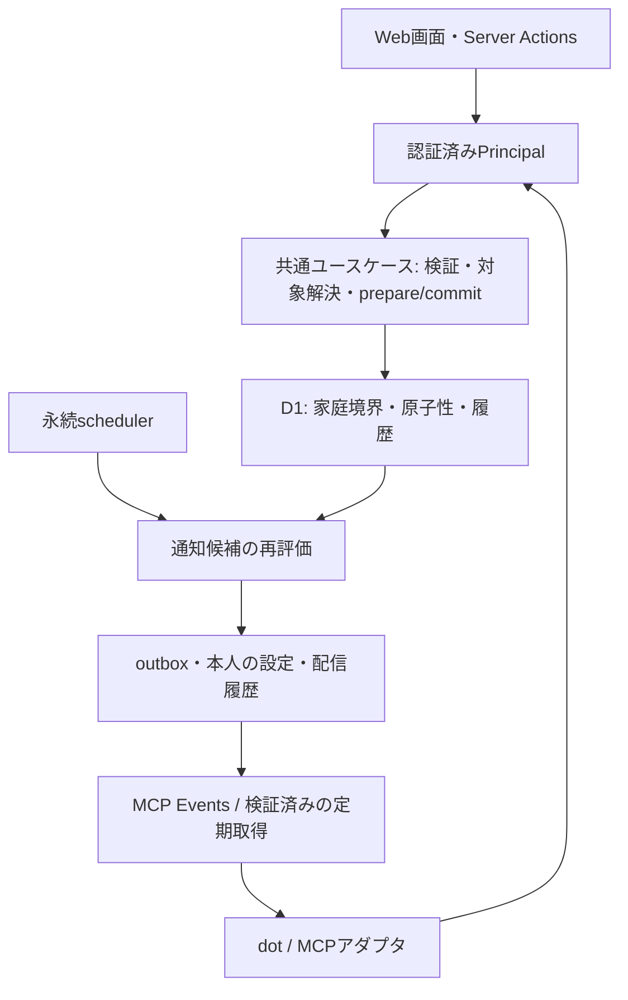

# 会話エージェント連携とリマインドの設計

## 適用範囲と現在地

[プロダクト計画](yamoru-project-plan.md)のv0.21.0を具体化する、[#189](https://github.com/upu/YAMORU/issues/189)の設計成果物である。[YDR-049](../decisions/ydr-049-conversation-command-boundary.md)が共通操作、[YDR-050](../decisions/ydr-050-conversation-reminders.md)が通知方針を定める。

本書はTool名・型・保存責務の実装契約である。提供済みの範囲と検証状況は以下の現在地と各Componentに記録する。親Issue #189は全子Issueと実接続確認が完了するまで閉じない。

2026-10-18時点で、既存Webの家庭境界・Todo完了/取消/訂正・補充に加え、OAuth接続と共通commandを使うMCP操作を実装し、previewの実dotで会話操作を確認した。定期取得の周期・重複抑止・停止は#442で、通知への完了・スヌーズ・予定変更・訂正/取消の返答は#443で実dot確認を完了した。#444の全体照合は[実接続と回帰検証](../references/conversation-integration-checks.md)に集約し、実dot、previewの実HTTP、ローカル試験の範囲を分ける。本人の無料運用の選択を[YDR-070](../decisions/ydr-070-free-polling-first.md)に記録し、v0.21.0は定期取得を先行する。未実証のMCP Events実配信は後続#474へ分ける。以下の「確認する」は各Issueの合格条件を示し、実装済みと実証済みを区別する。本番公開と実家庭での利用確認は別の段階である。

#435の共通読み取り入口・revision・検索上限・cursorと配備前提は[会話読み取りComponent](../components/conversation-read.md)に記載する。#436の認証と共通読み取りをMCPへ接続するのは#439で行う。

#436で外部クライアントの認可(3節)と接続管理を実装した。方式と採用ライブラリは[YDR-052](../decisions/ydr-052-oauth-authorization-server-on-d1.md)、入口は[外部連携の修正箇所マップ](../components/integration.md)に記録する。受付は許可するclient_idを設定するまで無効であり、previewで実dotの接続・本人照会を実証した。#444では実dotの別家庭の取得・変更拒否と、previewの実HTTPで未所属の同意拒否を確認した。未所属のdot接続を成立させたという意味ではない。

#437の第1段階として、5節の共通基盤(操作ID・fingerprint・10分のpreview・受付記録・再送時の保存結果・#435の家庭世代による競合検出と`expected_revision`)と、`todo.complete`・`todo.correct`・`todo.undo`を実装した。続いて`todo.create`、`managed_item.create`、`managed_item_with_todo.create`、`todo.reschedule`、`managed_item.update`、`todo.update`を実装した。受付記録の確定方式は[YDR-054](../decisions/ydr-054-integration-command-receipts.md)に記録する。追加確認(`confirmation_url`、確認画面、`operation_get`の確認状態と`confirmation_token`)は、古いpreviewの作り直しで意味のある差分が出た操作だけを対象として実装した([YDR-062](../decisions/ydr-062-integration-command-confirmation.md))。

2026-10-18時点で、#438の在庫command、#440の候補生成、#441の本人設定・配信履歴、#439の認証付きMCP入口を実装した。[MCP Component](../components/mcp.md)に公開schema・権限・検証入口を示す。ローカルの公式SDKとビルド済みWorkerの検証に加え、previewで実dotの登録・取得・完了・次回確認・解除/再接続・権限不足・曖昧な対象の検索を実証し、同Componentに記録した。定期取得の通知到達は#442、通知への返答は#443、今回の実接続E1/E2/E4/E5/E6/E7/E8は#444で照合する。E3とE6のEvents購読部分は#474へ分ける。

## 1. 家庭での操作とToolの対応

#440の通知候補生成・発生区間・差分cursorは[通知候補Component](../components/attention.md)で具体化する。本人設定・配信・実接続は後続Issueであり、共通読み取りの実装だけでは通知を有効にしない。

発話はすべて架空の例。対象名や会話の文脈だけでIDを確定できないときは検索候補を示す。

| # | 発話・目的 | 呼び出し | 確認する点・返す結果 |
|---|---|---|---|
| U1 | 「そろそろやることはある？」 | `attention_get` → 必要なら`entity_get` | 必達日、予定日、目安、在庫の理由を別々に説明。算出時刻と続きの有無を返す |
| U2 | 「浄水器を登録して、交換を実施から30日ごとに」 | `entity_search` → `command_prepare`/`command_commit` | 管理対象の重複候補、最初の実施日または初回予定、周期の意味を確認。作成された対象とTodoを返す |
| U3 | 「毎週土曜に掃除。担当は未定」 | 同上、`todo.create` | 土曜の暦規則と「実施から7日」を区別。初回予定と担当未設定を返す |
| U4 | 「フィルターを最後にいつ、誰が交換した？」 | `entity_search` → `entity_get`/`history_list` | 訂正後の有効値、元の記録と訂正の関係を返す |
| U5 | 「昨日フィルターを交換した」 | 対象解決 → `todo.complete`をprepare/commit | 実施日と記録日を分け、対象Occurrenceだけを完了。次回予定を返す |
| U6 | 「さっきの完了は一昨日、実施したのは家族B」/「取り消して」 | `operation_get` → `todo.correct`/`todo.undo`をprepare/commit | 対象の完了記録、変更差分、次回への影響。後続更新があれば安全に拒否 |
| U7 | 「洗剤は少ない」/「まだ残っている」/「買い足した」 | 対象解決 → `stock.observe`/`stock.refill`をprepare/commit | 観測と補充を分離。「残っている」だけなら状態を断定せず確認。数量や使用開始を創作しない |
| U8 | 「朝9時にまとめて知らせて。夜は静かに」 | `notification_settings_get` → `notification.configure`をprepare/commit | 本人だけに効く時刻・タイムゾーン・静かな時間と通知先を確認。家庭の期限は不変 |
| U9 | 通知へ「やった」「明日教えて」「予定を来週へ」 | `attention_get`/`entity_get` → `todo.complete`/`notification.snooze`/`todo.reschedule`をprepare/commit | 通知と対象の対応、現在状態、延期の意味を確認。家族が完了済みならその事実を返す |
| U10 | 「連携を解除したい」/「通知が来ない」 | `connection_get`、`delivery_list`、YAMORUの接続管理画面 | 解除は本人の明示操作。権限・静かな時間・期限・失敗段階と回復手順を表示 |

Webの通常操作を残し、接続管理はアカウント設定から到達させる。登録/完了は記録を残す操作、通知設定/muteは戻せる本人設定、完了取消は条件付き操作として説明する。正規表現や内部ID入力を利用者へ要求しない。

## 2. 責務と既存コードへの接続



候補配置は`src/features/integration/`に共通の入力/出力・ユースケース、`src/lib/d1/`に永続処理、MCP transportに薄い変換層とする。Webのredirect/revalidateはWeb側へ残す。新規ファイルの実在を示すパスではなく、#435で入口を作って[Components索引](../components/index.md)へ登録する。

| 既存の入口 | 再利用するもの | 後続で補うもの |
|---|---|---|
| `src/lib/d1/authorization.ts`、`context.ts` | 利用者と家庭所属の導出、家庭IDでの絞り込み | 外部tokenを検証してからPrincipalへ変換。入力のuserIdで`getD1Context`を呼ばない |
| `src/lib/d1/todos/index.ts` → creation/edit/recurring-edit | 5方式の登録、現在回/次回以降の区別、snapshot | 構造化入力、全変更の操作receipt、revision |
| `src/lib/d1/todos/completion.ts`、`corrections.ts` | 条件付きbatch、二重完了防止、安全な取消、追記型訂正 | payload全体のfingerprint、結果再取得、期限付きpreview、実行境界の競合検出 |
| `src/lib/d1/consumable-stock-history.ts` | 在庫3状態、観測と補充、追記型訂正、操作IDごとの結果保存 | #438でWebと共通commandの保存処理を共有。MCPの公開は#439 |
| `src/lib/d1/calendar.ts`、`src/app/task-schedule.ts`、`pending-todo.ts` | 暦計算とホームの状態分類 | UI依存を切り離した共通のprojection。画面/APIの一致テスト |
| `src/lib/d1/cross-search.ts`、`text-search.ts` | 家庭内の名前検索 | 別名・表記揺れの一致理由と候補選択。通常画面の検索拡張判断#351は別 |

外部アダプタにSQLや新しい日付計算を複製しない。既存関数を順番に呼ぶだけで原子性が保証されるとは扱わない。複数作成、業務更新とreceipt/outboxは同じ永続処理へ統合する。

## 3. 認証・家庭境界・接続管理

### Principalと権限

サーバー内部のPrincipalは`userId, householdId, clientId, connectionId, scopes`を持つ。Webは検証済みAuth.jsセッション、外部は検証済みOAuth grantから構築する。外部grantは接続時の家庭へ固定し、現在の所属が変わった場合は旧接続を失効させる。家庭の再所属を理由に過去のgrantを別家庭へ自動転用しない。

| scope | 許可する範囲 |
|---|---|
| `household.read` | 同じ家庭の対象・予定・履歴・在庫を読む |
| `household.write` | 許可された家庭の登録・変更・完了・訂正。readを併せて要求 |
| `notifications.manage` | 本人の設定・スヌーズ・配信履歴。readを併せて要求 |
| `events.subscribe` | 本人向け通知候補の購読と、定期取得経路の配信確保・結果報告。readを併せて要求 |

scopeは家庭メンバーのOwner/Member区分ではない。読み取りだけの外部接続を選べる。Tool・購読・結果再取得・配信の各入口でscope、現在所属、対象の家庭、接続の失効を検証する。他家庭のIDは存在の有無を明かさず`not_found`。operation/preview/cursorも本人・家庭・接続に束縛する。

### OAuthの契約

HTTPS上のMCP resourceとauthorization serverを分けて定義する。YAMORUの既存ログインを認証と同意画面へ利用し、OAuth処理は検証済みライブラリを再利用する。Auth.jsがそのままMCP向けauthorization serverになるとは扱わない。#436は採用ライブラリ・バージョンと適合テスト結果を記録してから接続を有効にする。

- authorization code + PKCE S256、完全一致の登録済みredirect URI、一回限り・短命のcode、CSRF対策、resource/audience束縛を必須にする。productionとpreviewのissuer/resourceは別にする。
- metadata discovery、clientの識別/登録、scope challengeを接続先と検証する。CIMDを第一候補とし、必要なら検証した事前登録clientまたはDCRを使う。URLからmetadataを取得するときもSSRF対策を行う。
- grantは本人・家庭・client・scope・失効状態を保持。access tokenは短命、refreshはローテーションと再使用検知を備える。tokenの形式にかかわらずissuer、audience、期限、scopeと現在のgrantを毎回確認する。
- 同意画面には接続先、家庭名、読める/変更できる範囲を表示する。`events.subscribe`は通知の受信に加え、定期取得時に候補を確保して案内結果を報告できる権限だと説明する。通知設定の変更権限だけでは配信を確保できない。秘密は専用の認証フローで扱い、会話・Issue・ログへ貼らせない。ブラウザーCookie、D1鍵、管理API鍵を渡さない。
- 解除時にgrant・refresh・preview・購読を無効化し、未送信候補を止める。再接続は新grantとして同意を取り直す。解除前の履歴は残し、過去の通知への返答で操作を再開しない。

方式の根拠は[OpenAIの認証仕様](https://developers.openai.com/plugins/build/auth)と[MCP認可仕様](https://modelcontextprotocol.io/specification/2026-07-28/basic/authorization)。上記はYAMORUが満たす設計要件であり、このアカウントでの接続成功を示さない。

## 4. 読み取りToolの共通契約

wire形式はJSON。名前はsnake_case、ID/revision/cursorは意味を推測しない文字列、日時はoffset付きISO 8601、暦日は`YYYY-MM-DD`。不明なキー、無効なenum、範囲外の値を拒否する。日付の詳細は6節に従う。

| Tool | 入力 | 主な出力・上限 |
|---|---|---|
| `connection_get` | `{}` | 本人と家庭の表示名、接続ID、許可scope、接続状態、`capabilities`、認証導線。秘密は返さない |
| `entity_search` | `query, kinds[], cursor?, limit?` | `candidates[{kind,id,name,match_reason,revision,updated_at,detail_url}], next_cursor`。既定20、最大50 |
| `entity_get` | `kind, id` | 対象と関連ID、revision、現在状態、日付projection、許可操作。関連の全件展開はしない |
| `history_list` | `kind, id, cursor?, limit?` | 記録ID、実施/記録日時、actor/client/performer、有効値と訂正元ID。既定20、最大50 |
| `attention_get` | `cursor?, limit?, candidate_ids?` | `candidates, removed_ids, next_cursor, generated_at, next_check_at`。候補は既定20、最大50、ID指定も最大50 |
| `operation_get` | `operation_id` | `prepared / succeeded / rejected / expired / unknown`、保存結果、再取得方法、確認状態。確認済みで未実行なら元commandのscopeも検証し`confirmation_token`を返す。別接続のreceipt/tokenは返さない |
| `notification_settings_get` | `{}` | 本人の設定とrevision、適用中の次回通知時刻 |
| `delivery_list` | `cursor?, limit?` | 本人向け候補ID・状態・見送り理由・最終試行時刻。既定20、最大50。callback URLやsecretは返さない |
| `notification_context_get` | `delivery_id, candidate_id?` | 元の回/消耗品、現在状態、`selected.notification_reference`。複数件は`selection_required`で選択し、欠落件数は`missing_count`。source不明/90日超過/削除は選び直す。最大50件、leaseや秘密は返さない |

対象kindは`managed_item / todo_rule / todo_occurrence / consumable`。名称が一致しても複数候補は確定しない。関連名・別名に一致した場合は一致フィールドと短い理由を返す。ページ順は安定キーで固定し、cursorへ検索条件・家庭・主体を束縛する。期限切れcursorには`cursor_expired`と安全な再取得方法を返す。

各読み取り結果に`schema_version: 1, request_id, as_of`を付ける。メモ等は利用者作成データと明示し、Tool実行指示を混ぜない。外部へ返すフィールドは各ユースケースに必要なものに限定する。

## 5. prepare/commitと変更Tool

### 入出力

`command_prepare`入力:

```json
{
  "operation_id": "client-generated-uuid",
  "command": "todo.complete",
  "target": { "kind": "todo_occurrence", "id": "occ_example" },
  "expected_revision": "rev_example",
  "payload": { "occurred_on": "2026-10-16", "performer_id": null }
}
```

出力は`operation_id, status, preview_id, expires_at, normalized_command, affected_entities, diff, schedule_effect, confirmation, fingerprint`。`confirmation`は`state(not_needed / required / unresolved), reason_codes[]`を持ち、requiredでは`confirmation_url`と`expires_at`も返す。未解決の必須値があればcommit可能なpreviewを発行しない。previewは10分有効で、期限はサーバーが返す。prepareは業務データを変更しないがpreview/receiptを永続化するため、MCPのreadOnly扱いにはしない。

対象を新規作成するcommandではtarget/revisionを省略し、関連する既存IDのrevisionをaffected_entitiesへ含める。個人設定は本人の設定revision、訂正は対象記録と現在の投影のrevisionを使う。prepareとcommitの両方でcommand別のscopeをサーバー側から引き、要求内に書かれたscopeは採用しない。

通知への返答では`notification_context_get`で対象を照合し、`command_prepare`に任意の`notification_reference: {delivery_id,candidate_id}`を添える。これは通知に保存された元対象の検査を追加する入力であり、scopeや利用者の指示の代わりにはならない。完了/訂正/取消、予定変更、本人スヌーズ、在庫の観測/補充/訂正に対応し、prepare・commitの再計画・業務と同じbatchで照合する。詳細とrollback条件は[YDR-071](../decisions/ydr-071-notification-reply-reference.md)。参照なしの通常操作は従来どおりとする。

`command_commit`入力は`operation_id, preview_id, fingerprint`と、確認必須の場合のサーバー発行`confirmation_token`のみ。payloadを再入力させない。tokenは認証済みYAMORU確認画面で該当previewへ同意したとき発行し、同じ主体・内容・期限へ束縛する。日常の明確な操作では追加確認画面を要求しない。MCPクライアント固有の確認UIが追加で要求される場合はそれに従う。

追加確認は次の手順で完結させる。どの場合に確認を必須にするかと、作り直しの追跡・比較の方法は[YDR-062](../decisions/ydr-062-integration-command-confirmation.md)に従う(古いpreviewの作り直しで意味のある差分が出た操作だけ)。

1. `confirmation_url`はYAMORU自身の`/settings/integrations/operations/{preview_id}/confirm`を指す。IDは推測困難とし、URLへtokenや家庭情報を含めない。リンクを開くGETだけでは承認しない。
2. Webログイン後、previewの本人・家庭・接続・元commandのscopeを確認する。接続元と確定差分、次回への影響を表示し、承認/拒否をCSRF保護されたPOSTで記録する。承認時もpreview期限とrevisionを再確認し、変更済みなら承認せず再prepareへ戻す。
3. 画面は利用者へ元の会話へ戻るよう案内する。クライアントは同じ`operation_id`の`operation_get`から`confirmation_status: pending / approved / denied / expired`を取得する。approvedかつ未実行の場合だけ、元と同じ本人・家庭・client・接続と必要scopeへ`confirmation_token`を返す。利用者にtokenのコピーや貼り付けを求めない。
4. tokenはpreview/fingerprint/接続/期限に束縛し、暗号化保存、ログ非出力とする。commitで検証して一回だけ消費する。同じ操作の成功後の再送は消費済みtokenで再実行せず保存結果を返す。拒否・解除・期限切れはtokenを無効化し、競合は確認を引き継がず新しいpreviewへ戻す。

成功出力は`status: succeeded, operation_id, replayed, recorded_at, result`。resultは対象ID・新revision・実施日・次回Occurrence/予定・履歴ID・`undo_available`と理由・詳細リンクを持つ。すでに他の家族が完了した場合は`already_resolved`と現在状態を返し、この操作が完了したと表示しない。

### command別payloadと副作用

すべての変更は上記2Toolを通る。MCPはcommandごとのdiscriminated unionを公開し、任意SQLや任意メソッドを受け取らない。

| command | payloadの必須項目・条件 | 副作用と担当 |
|---|---|---|
| `managed_item.create` | `name, kind(asset/service)`、任意の商品情報・関連リンク・タグID。初期値は既存フォーム規則 | 管理対象作成。#437 |
| `managed_item.update` | ManagedItem対象/revisionと既存Webで編集可能な`changes` | 家庭内の管理対象を変更。削除/アーカイブを含めない。#437 |
| `todo.create` | `title, recurrence`、任意`managed_item_id, note, assignee_id`。recurrenceは`one_time / manual / completion / calendar / interval`の型別入力 | Ruleと最初のOccurrenceを一括作成。#437 |
| `managed_item_with_todo.create` | 上記2つのpayload。Todoは作成対象へ関連付け | 2つの独立commitにせず全成功/全取消。#437 |
| `todo.update` | `edit_scope(current_occurrence/future_rule/manual_combined/one_time_combined), changes`、対象revision。combinedは`rule_changes`と`occurrence_changes`を受け取り、一方または両方を指定可。繰返し方式そのものの変更は不可 | 暦を持つ繰り返しは現在回と次回以降を分離。manualは[YDR-046](../decisions/ydr-046-manual-recurrence-todos.md)、one_timeは既存`updateOneTimeTodo`に従い、Ruleと現在Occurrenceを一つのpreview/commitで全成功/全取消にする。過去回は変更しない。#437 |
| `todo.complete` | Occurrence対象、`occurred_on`または`occurred_at`の一方、任意`performer_id`。日時省略は「今」としてprepare時刻へ固定しpreviewに明示 | 完了履歴、現在状態、次回を一括更新。#437 |
| `todo.correct` | `completion_log_id, changes`。changesは`occurred_on`・`performer_id`の一方または両方を含む空でないオブジェクト | 全項目を一つのpreview/commitで追記訂正。日時訂正は次回未変更ガード。入力検証・revision確認・訂正履歴・現在値・次回更新を全成功/全取消とし、項目別commitへ分割しない。#437 |
| `todo.undo` | `completion_log_id`、対象revision | 次回が未変更のときのみ完了取消。#437 |
| `todo.reschedule` | `new_due_on`、対象Occurrence/revision | 今回の期限を変更。本来の予定・必達日は変更しない。必要時Todoは拒否。#437 |
| `stock.observe` | Consumable対象、`observed_on`または`observed_at`、`stock_status(available/low/out)`、任意の`performer_id` | 観測履歴と順序が確定した現在の在庫表示。補充日は不変。#438 |
| `stock.refill` | Consumable対象、`refilled_on`または`refilled_at`、任意の`performer_id` | 補充履歴と順序が確定した在庫「ある」。購入/使用開始日時や数量を創作しない。#438 |
| `stock.correct` | Consumable対象、`record_id, record_revision`と`changes`または`void: true` | 元記録を消さず訂正。`changes`は元記録の実施日/時刻・`stock_status`・`performer_id`の指定項目だけを変更。後続観測を過去の状態で上書きしない。#438 |
| `notification.configure` | 設定revisionと`enabled, time_zone, digest_time, quiet_hours, repeat_policy, muted`の変更値 | 本人の設定のみ。#441 |
| `notification.snooze` | `candidate_id, until`、候補revision | 本人の候補を延期。家庭の期限や他人の通知は不変。#441 |

recurrenceの値は既存の入力検証と暦規則を再利用する。one_timeは予定暦日または未定、manualは日付なし、completionは日/月/年と推奨範囲・初回予定、calendarは曜日/月日等の構造化候補列、intervalは起点暦日と日/週の間隔を必要とする。自然言語から未指定の初回予定や期間を創作しない。必達日の保存/更新規則は#51のYDRを共通入力へ反映し、未対応の間はcapabilitiesで返して黙って捨てない。

在庫の日時は日付かタイムゾーン付き時刻の一方だけを指定する。時刻の`now`はprepare時の絶対参照時刻へ固定する。`application: history_only`なら現在表示を変更しない。同日の異なる状態など実施順序が不明なら`missing_required`を返し、実際の時刻、履歴だけを加える意図、または`current_observation: { stock_status, performer_id? }`を求める。現在の観測を補充・訂正と同時に記録する場合も原子的に保存する。`performer_id`省略は本人、明示nullは不明、訂正で省略した実施者は元の値を保持する。取消後は訂正で再び有効にできる。詳細な移行と状態計算は[YDR-057](../decisions/ydr-057-stock-observation-and-refill-history.md)を参照する。

台帳削除・アーカイブ、任意の過去履歴削除、消費予測、数量管理、繰返し方式変更は本契約に含めない。消耗品の追加登録/名称等の編集は既存Webを案内し、v0.21.0の会話変更は観測・補充・訂正へ限定する。

`todo.update`はサーバーが対象の方式とedit_scopeの組み合わせを検証する。`calendar/completion/interval`にはcurrent_occurrence/future_rule、`manual`にはmanual_combined、`one_time`にはone_time_combinedを使い、別方式のscopeを拒否する。combinedのRule側は名前・関連対象・メモ、Occurrence側は担当とし、one_timeのみ予定日（具体日または未定）も受け付ける。manualへ日付を設定しない。Rule/Occurrence双方のrevisionを同じ原子的処理で検証し、現在snapshot、既存の編集履歴、receiptを同じ成功条件へ束縛する。one_timeの予定日変更時は既存Webと同じscheduled_for/due_at更新規則を使い、延期とは区別する。#437では一回限りの名前・担当・予定日の同時変更に競合/途中失敗を注入し、すべて変更されないことを検証する。

### 冪等性・競合・確認

1. clientは意図した一操作につきUUIDを一度生成し、通信再試行でも維持する。サーバーは本人・家庭・client・接続と操作IDの一意性を保証する。fingerprintにはcommand、確定対象、正規化payload、参照revisionを含める。相対日付はprepare時に固定する。再prepareでは元の要求のcanonical hashで同内容を照合して保存済みの正規化値を使い、「今」や「昨日」を再計算しない。
2. 同ID/同内容のprepareは同じpreviewまたは保存結果を返す。別内容は`idempotency_conflict`。commit再送は、現在の認可を再検証した上で、成功済みならpreview期限後も保存結果を返す。期限切れで未実行の操作を勝手に再prepareしない。
3. revisionはupdated_at単独にしない。対象、Rule/snapshot、関連する完了/訂正、取消対象の次回など、結果に影響する参照集合を含める。DB上の単調増加versionを旧Workerの変更も捕捉するtrigger等で更新する。必要な世代がない間は外部のcommitを有効にしない。
4. commitは認可・参照集合のrevision・状態・preview期限を業務更新と同じ原子的処理で再確認する。事前SELECTだけでは不十分。条件付き更新0件を成功と扱わず、receipt成功記録・履歴・次回生成・outboxも同じ成功条件に束縛する。途中失敗でいずれかだけ残る実装を禁止する。
5. D1のbatchを使う場合、関数ごとの別batchを呼んで全体が原子的と誤認しない。[D1 batchの仕様](https://developers.cloudflare.com/d1/worker-api/d1-database/#batch)に沿い、SQL制約によるrollbackと条件付き更新の両方を実D1で検証する。
6. commit競合は`stale_preview`で差分再確認へ戻す。明確な発話でも内容が変わった場合は自動承認しない。再prepareは最新状態を読んだ新操作IDへ移り、変更された差分には`confirmation: required`を返す。確認必須のpreviewは3節の認可とは別に、本人の確認tokenを必要とする。
7. 結果不明なら`operation_get`で照合する。`unknown`や通信タイムアウトを未実行と決めつけて新IDで再登録しない。成功receiptの詳細は30日保持し、その後も操作ID・fingerprint・成功状態・対象履歴IDの最小記録を家庭データの存続期間中保持する。詳細破棄後は`result_expired`を返し再実行しない。

再接続でconnectionIdが変わった場合、外部Toolから旧接続のreceiptを取得できない。本人のYAMORU操作履歴画面で照合し、確認前に新IDで再登録しない。家庭から離脱した本人には旧家庭の履歴を返さない。

### エラーと再試行

共通エラーは`code, message, retryable, retry_after?, operation_id?, field_errors?, recovery`。認証不備はHTTP 401/403と認証challenge、入力/業務エラーはToolの構造化エラーへ変換する。SQLや秘密を返さない。

| code | 利用者への意味・回復 |
|---|---|
| `unauthenticated / connection_revoked / insufficient_scope` | ログイン/再接続/必要な権限。自動で権限を拡張しない |
| `not_found / no_household` | 対象を読めない/家庭への所属が必要。他家庭の存在を示さない |
| `ambiguous_target / missing_required / invalid_input` | 候補または不足項目だけ確認。何も変更しない |
| `stale_preview / preview_expired / confirmation_required` | 現在状態を読み直し、必要な確認後に新操作を作る。`confirmation_required`は確定させず、本人の承認後に同じ操作IDで実行できる |
| `confirmation_denied` | 本人が確認画面で取りやめた。変更せず説明し、必要なら内容を確かめて新しい操作を作る |
| `idempotency_conflict / already_resolved / unsafe_undo` | 同ID別内容/完了済み/後続更新あり。変更せず説明 |
| `rate_limited / temporarily_unavailable` | Retry-After後に同IDを再試行。結果不明なら先に照合 |
| `cursor_expired / result_expired / unsupported_capability` | 全体再取得/履歴参照/対応機能の案内。再実行や全件無制限取得をしない |

#436/#439で利用者・接続ごとのrate limitとページ上限を適用する。初期運用値は読み取り60回/分、prepare/commit各20回/分、同時commitは接続あたり2件。limit超過は期限や履歴を変えず拒否し、実測で調整する。

## 6. 日付・履歴・在庫の不変条件

- `occurred_at`は実施、`recorded_at`はサーバー記録時刻。日付だけの入力は既存Webと同じAsia/Tokyoの変換を使い、`date_precision: day`も返す。「今日/昨日」は接続の家庭基準日を示して絶対日に解決する。未来の完了を拒否する。
- `scheduled_for`は本来の予定、`due_at`は現在の期限。必達日は#51で独立した`must_complete_by`としてAPIへ投影し、推奨上限やdue_atの別名にしない。永続列は`task_occurrences.must_complete_by`（任意の東京暦日）。[YDR-051](../decisions/ydr-051-occurrence-hard-deadline.md)に従い各回で設定・変更・解除し、次回へコピーしない。
- 推奨範囲は`recommended_window{start,end,state}`、必達日は別の期限区分として返す。予定なし、目安前、そろそろ、範囲内、超過を既存ホームと整合させる。manualに日付を創作しない。
- 予定計算はAsia/Tokyoの既存YDRを維持する。本人の通知time_zoneは表示・配信時間帯だけに作用し、Ruleの暦計算を変えない。DSTのない時刻は次の有効時刻、重複時刻は最初の一回とし、設定previewに次回の実時刻を返す。
- 完了は発生時のsnapshot、次回以降の編集は現在のRuleを使う。延期、実施日訂正、完了取消でそれぞれ何が変わるかをprepare結果へ出す。
- actorは本人、clientはWeb/dot等の認証済み接続元、performerは既定で本人、明示時は同じ家庭の実施者。クライアント指定のactorを信頼しない。
- 在庫観測と補充は実施日・記録日時・記録元を保持する。過去日の記録/訂正は最新の有効な観測・補充より新しい事実を巻き戻さない。日単位で順序を断定できない競合は確認を求める。旧履歴の実施者や観測日が不明ならunknownとして残し、移行で推測しない。

## 7. 候補・通知設定・配信状態

#441の本人設定・スヌーズ・配信履歴、共通commandの入口と#442への引き継ぎは[個人の通知Component](../components/notifications.md)に記録する。設定の保存と配信可否の判定までを実装し、実際のscheduler/outbox/lease/配信は#442で追加する。

### 候補と設定

候補は`candidate_id, kind, entity_id, occurrence_id?, revision, reason_codes[], priority, dates, generated_at, next_check_at, detail_url`を持つ。Todo完了/取消/アーカイブ済みと在庫回復済みは除外する。ただし完了取消でpendingへ戻ったOccurrenceは再評価する。過去に取消履歴があるだけで除外しない。候補IDは対象・理由の発生区間で安定させ、同じ条件の再走査で増やさない。状態が一度解消して再発した場合は新しい区間とする。

理由は`hard_deadline_overdue / hard_deadline_today / scheduled_due / maintenance_soon / maintenance_window / maintenance_overdue / stock_out / stock_low`を分ける。順序は必達日超過→必達日当日→現在期限→在庫なし→目安超過/範囲内/そろそろ→在庫少。区分内は該当日、対象IDの順。AIは優先度を作り直さない。

未完了の目安が変わっただけで毎回別通知にしない。配信の重複判定は本人・接続・候補区間・通知回の組み合わせで行い、revisionは鮮度確認に用いる。差分cursorには削除/無効化IDも含め、保持期間を超えたcursorは失効させて上限付きの全件再取得へ戻す。

初期値は通知無効、有効化時の案は朝9時の一日一回まとめ・Asia/Tokyo・静かな時間22時〜8時・自動再通知なし。本人が変更できる。再通知を有効化した場合はhigh/normal別の間隔を24時間以上で選び、同じ候補の自動再通知は最大3回とする。mute/snooze、完了、解除が優先する。設定変更時は未送信候補の次回時刻を再計算する。

### 永続処理と状態遷移

YAMORU側のschedulerは5分間隔を初期目標として期限と未処理outboxを走査し、更新時にも候補を再評価する。これは稼働時の処理目標であり、外部通知の到達保証ではない。Cloudflareの定期起動処理から共通処理を呼び、プロセス内timerや`waitUntil`だけを永続schedulerの代わりにしない。#442で実ランタイムと実測遅延を記録する。

1. 候補/変更の永続化とoutboxを整合させる。時間経過で発生する候補は定期走査が同じ一意キーで作る。
2. workerは期限付きleaseを条件付き更新で取得する。lease世代を持ち、失効したworkerは結果を上書きできない。送信開始を記録してから送る。
3. 送信直前に本人の所属、grant、購読期限、静かな時間、mute/snooze、対象状態を再評価する。静かな時間・snoozeによる一時延期は、未送信の`leased`を`pending`へ戻してleaseを解放し、両方の制約を満たす最初の配信可能時刻を`next_attempt_at`へ保存する。送信/再通知の回数を増やさず、同じ配信IDを定期走査で再取得する。設定変更でもこの時刻を再計算する。外部へ渡したデータの回収までは保証できない。
4. 状態は`pending → leased → sending → accepted / retry_wait / unknown / failed`を基本とし、未送信の`leased → pending`は上記の一時延期、`pending/leased → cancelled/suppressed`はその配信の終了を表す。`accepted`はWebhook受領。`suppressed`は対象完了や候補解消など、同じ配信を再開しない除外に限定し理由を記録する。接続解除・通知無効・muteは未送信分を`cancelled`とする。通知を再有効化した際は未案内の有効候補を再評価し、終了済み配信とは別の配信試行を作る。一時延期を配信済みや自動再通知として扱わず、既読状態も提供しない。
5. 応答が失われた送信やsending中のlease切れは`unknown`。無条件にpendingへ戻さない。接続先の照合/重複排除能力を実証できる場合だけ同一イベントIDで再試行し、できなければ回復案内を出す。既知の一時失敗は指数backoffとjitter、最大8回/24時間で打ち切る。401/403は接続再確認、410は購読停止、413はpayload修正とし無条件再送しない。
6. 配信後に家族が完了する競合は起こり得るため、dotが案内/変更する直前にも`attention_get`で現在状態を確認する。候補取得だけでは配信済みにしない。

### MCP Eventsと定期取得の境界

[OpenAIのMCP Events仕様](https://developers.openai.com/plugins/build/mcp-events)を2026-10-17に確認した。dots向けにはMCP 2.0 (`2026-07-28`)のWebhook購読を前提とし、`server/discover`、`events/list`、`events/subscribe`、`events/unsubscribe`を実装・検証する。既存SDKが対応するとは推定しない。

Eventsの以下の契約は後続#474の採用条件として保持する。v0.21.0は[YDR-070](../decisions/ydr-070-free-polling-first.md)に従って無料運用と定期取得を先行し、Eventsの購読・実配送・購読解除/失効を今回の必須条件にしない。preview/productionの送信providerは未設定を維持し、到達制約を通常fetchやTLS検証無効化で迂回しない。

YAMORUのイベント名は`attention.ready`、payloadは`candidate_ids, delivery_id, generated_at`とし、家庭の全文や実行命令を埋め込まない。利用者が監視の目的と対象を選び、認証された購読から本人の候補だけを届ける。実行時に上限付き読み取りToolで詳細を取得する。

購読は本人・家庭・grant・event・正規化filter・callbackに束縛して永続化し、更新/解除を冪等にする。callback検証と配送は署名付きHTTPSに限定する。秘密は暗号化して保存し、公開ログへ出さない。private/local宛てとredirectを拒否し、DNS再束縛を防ぐ接続時の検証を含める。Workersの標準fetchだけでこの要件を満たせない場合は、検証可能なegress手段を用意するまでcallback配送を有効にしない。

イベントIDは再試行で維持し、署名は毎回更新する。2xxは受領のみで、処理は非同期。受信側のbatchingもあり、遅延をゼロと見なさない。署名方式や詳細なwire schemaは公式資料を再確認して実装する。

v0.21.0では、本人が別途設定した接続先の定期実行主体が`attention_get`を呼ぶ。初期候補は15分間隔で、保存済み周期・予定時刻と実際の起動/案内・実測遅延を区別する。15分ぴったりの起動や到達の上限を保証しない。YAMORUの通知設定を保存するだけでは外部タスクは作られない。取得と案内が分かれるため、この経路では次のcommandを使う。

| command | 入力payload | commit結果と副作用 |
|---|---|---|
| `notification.claim` | `candidate_ids`（最大50）と各revision | 現在配信可能なものを一意に確保し、`delivery_id, lease_token, lease_expires_at, candidates, skipped_reasons`を返す。leaseは5分。prepareでは確保しない |
| `notification.ack` | `delivery_id, lease_token, outcome(reported/unknown)` | 確保した本人/接続/lease世代を検証し、配信履歴を更新。重複ackは同じ結果、別outcomeは競合 |

これらもprepare/commitと操作IDの契約に従い、本人の`events.subscribe`と`household.read`を要する。`notifications.manage`だけの接続はprepare/commitとも拒否する。claim/ackは本人・家庭・接続・有効な配信設定とleaseへ束縛し、別接続宛ての配信を確保・報告できない。家庭の業務データを変更しない。ackのreportedはクライアントの案内報告であり既読ではない。lease切れの送信不明は同じunknown規則で扱う。自動実行主体を確保できない場合、通知完成を主張せず#442/#444を未完了として残す。

返答は`notification_context_get`で`delivery_id/candidate_id`から保存済みの元Occurrence/消耗品と現在状態を解決する。通知に複数件ある「やった」はどれか確認する。一部の詳細が消えても残りを勝手に選ばない。通知の期限切れ/接続失効では変更せず、現在の候補を選び直す。参照付きcommandは元対象と一致する場合だけ実行し、新しいOccurrenceへ暗黙に付け替えない。自己発行イベントで繰り返し完了や通知ループを起こさない。

## 8. 保存・移行・運用

| 永続化する責務 | 境界・保持方針 | 主担当 |
|---|---|---|
| grant/token参照・preview/操作receipt | 本人・家庭・接続。生tokenはログへ出さず、検証に不要な秘密はhash、再送に必要なsecretは暗号化 | #436、#437 |
| 対象のrevision・参照集合 | Web/旧Workerの変更も捕捉。previewだけのversionは不可 | #435、#437 |
| 観測・補充・訂正 | 家庭共有の追記履歴、実施/記録時刻と不明値を区別 | #438 |
| 本人設定・候補・購読・outbox・配信lease | 共有期限と分離。失効後は未送信を停止。配信詳細は90日、重複排除用最小記録は候補区間の存続中保持 | #440〜#442 |

SQL名・制約・index・移行テストは担当Issueの実装と同時に決める。本設計で適用済みmigrationを書き換えない。[D1変更手順](../references/database-change-playbook.md)に従い、追加schema→旧Workerとの互換確認→新Worker→機能有効化の順に進める。旧Workerに戻しても既存UIが動き、外部commitと配送を止められるようにする。旧データから存在しない観測・実施者を生成しない。

追加したテーブル/関連は家庭IDを含めて制約し、家庭A/B・非所属・未認証・他家庭ID・同時実行・途中失敗のテストを揃える。外部の運用ログはrequest/operation/delivery ID、理由コード、試行回数、所要時間を中心にし、家庭データ本文・秘密・会話全文を残さない。本人が見る履歴は認可された画面/Toolだけで返す。

解除、送信停止、再接続、期限切れ購読、unknownの照合、滞留outboxの回収を管理画面で説明する。外部連携の停止中も既存Webを利用できる。実家庭の資格情報発行・本番データ操作・デプロイは本設計PRで行わない。

## 9. 実装順と検証による引き継ぎ

| Issue | 実装入口・設計の使用箇所 | 合格を証明するテスト/記録 |
|---|---|---|
| #189 | 本書、YDR-049/050、プロダクト計画・索引 | U1〜U10と全契約がレビューされ、設計PRがマージ済み。親は開いたまま |
| #51 | 必達日の永続化と表示。6節 | 目安との併存、必達日前/当日/超過、延期/訂正/取消、旧データの回帰 |
| #435 | 2〜4節、6節。共通読み取りとprojection | Web/API一致、候補の曖昧さ・別名、家庭境界、ページング、日付境界 |
| #436 | 3節、8節。認証・接続管理 | PKCE/metadata/resource/scope/期限、他家庭、解除後操作・配信停止、実認証の証拠 |
| #437 | 5〜6節。共通commandとreceipt | 同ID同内容/別内容、応答喪失、同時完了、古いpreview、旧Web更新、後続更新と取消、複合作成の途中失敗。複数項目訂正/manual一括編集の検証失敗・競合で全項目が未変更。requiredの確認URL→本人承認→同じ接続でtoken取得→commitと、他人・別接続・拒否・期限切れ・確認後競合の拒否 |
| #438 | 在庫の観測/補充/訂正 | 二重補充、過去日/同日競合、観測のみで補充日不変、未知情報の保存、家庭境界 |
| #439 | OAuth付きMCPアダプタ | 実dotで読み取り→登録→取得→完了→次回確認、再接続、切断・権限不足・データ内の命令文 |
| #440 | 7節の候補生成 | 空/多数/日付経過、必達日と目安、差分削除、安定順序、完了等の除外 |
| #441 | 本人設定と履歴 | 静かな時間・DST・スヌーズ・mute・設定変更、他人へ非干渉、既読を捏造しない。送信直前の静かな時間変更でも延期され、自動再通知なしの設定で時間明けに一度だけ配信対象へ戻る |
| #442 | scheduler/outbox/定期取得 | 実dotの定期取得による案内、保存済み周期・実測遅延、重複抑止・停止。lease失効、再起動、unknown、定期照合と回復を検証。設定変更権限のみ/別接続/解除済み設定によるclaim/ackを拒否し、配信状態が不変。実Eventsは#474 |
| #443 | 通知返答とcommandの対応 | 「やった/昨日/明日教えて/予定変更」、曖昧な複数件、古い通知、家族の同時完了 |
| #444 | 初回接続・復旧導線と全体E2E | 実接続記録と模擬テストを区別し、全合格条件を最終headで照合 |

厳密な依存は[マイルストーン](https://github.com/upu/YAMORU/milestone/21)と各Issueの前提欄に保持する。推奨順は#189設計確定→#51→#435/#436→#437→#438→#439→#440→#441→#442→#443→#444。#51を読み取りAPIより先、#439を通知実装より先にするのは手戻りを減らすためであり、追加の必須依存ではない。

後続#474は今回のmilestoneと#189の必須子Issueに追加せず、#443/#444の前提にしない。無料運用を保つ判断によって採用経路を変更するが、通知→返答、家庭境界、接続失効・解除、静かな時間、同時操作と復旧の完成条件は維持する。

### 実接続の検証手順と判定

架空データ専用のpreview家庭A/Bと同意済みのテスト接続を用意する。秘密を除いたprotocol version、SDK version、環境、commit、時刻、request/delivery ID、期待結果・実結果・遅延を担当PRに残す。資格情報は公開資料へ残さない。

| ID | 操作 | 合格条件 |
|---|---|---|
| E1 | 接続、scope同意、無害な本人/対象照会 | 実環境でmetadata/PKCE/Tool発見が成立し、家庭Bと未所属を拒否 |
| E2 | 登録→照会→過去日完了→次回確認→安全な取消/訂正 | 対象・実施日・次回・履歴がWebと一致。同ID再送で二重作成しない |
| E3（後続#474） | events discovery→購読→callback検証→架空候補発生 | 購読が永続化され、署名付きイベントが受領され、実dotが候補を再取得して案内。各段階と実測遅延を記録。v0.21.0の必須条件からは除外し、実証済みとは扱わない |
| E4 | 重複/順序逆転、応答喪失、再起動、lease切れを注入 | 新IDの乱発や二重完了なし。unknownは照合または回復案内。実現できない保証は未達として残す |
| E5 | 家族Bが先に完了、本人がsnooze、静かな時間に候補発生 | 未配信候補が無効/延期。家庭の期限・他人の設定は不変 |
| E6 | 定期タスク停止・本人通知停止・接続期限切れ/解除 | タスク停止後は自動起動が終わる。通知停止後は新規確保を、接続失効/解除後は確保と変更操作を拒否する。失効した返答を次回Todoへ転用しない。Events購読更新・期限切れ・unsubscribeだけは後続#474 |
| E7 | 接続先に定期取得を設定 | 実行主体・保存済み周期/予定・実際の起動/案内と遅延・lease/ack・重複抑止・回復・停止を実証。用意できない場合は通知未達と記録 |
| E8 | 配信済み通知へ完了/スヌーズ/予定変更を返答 | 操作の意味が区別され、複数件の曖昧さだけ確認し、結果と取消可否を表示 |

#444では既存lint/typecheck/unit/D1/E2E/buildと新契約のテストを最終変更で実行する。自動テスト成功は実接続成功の代わりにしない。v0.21.0はE1/E2/E4/E5/E6/E7/E8を照合し、E3とE6のEvents購読部分は#474で未達として保持する。今回に残る要件を満たさなければ該当Issueを開いたままにし、都度照会だけを通知完成と扱わない。
